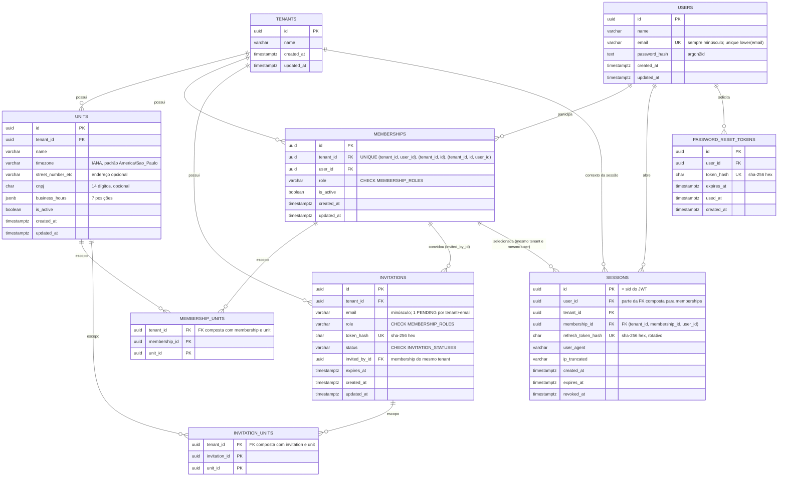

# Banco de dados

> Dono: `database-engineer` · Schema: `apps/api/prisma/schema.prisma` · Migrations: `apps/api/prisma/migrations/`
> Seed: `apps/api/prisma/seed.ts` (`pnpm --filter @barber/api db:seed`).

Convenções: tabelas/colunas `snake_case` (`@@map`/`@map`), modelos Prisma PascalCase; PK `uuid` (UUID v7
gerado pela aplicação via `@default(uuid(7))`); datas em `timestamptz`; dinheiro em centavos inteiros.
Constraints que o Prisma não expressa (CHECK, índices funcionais/parciais, RLS) ficam na parte manual de cada
migration, comentadas.

## 1. Diagrama ER — autenticação, tenants e memberships



### Decisões de modelagem

- **`role`/`status` como `varchar` + `CHECK`** (não enum nativo) — decisão da ADR 0002 / `docs/plans/auth.md`
  §3, para não exigir `ALTER TYPE` a cada papel novo. Valores espelham `MEMBERSHIP_ROLES` e
  `INVITATION_STATUSES` de `packages/shared/src/enums.ts`: **mudou o enum lá, precisa de migration trocando o
  CHECK aqui**.
- **`tenant_id` duplicado em `membership_units`/`invitation_units`** em vez de RLS via join: a policy fica
  `tenant_id = ...` (simples e indexável) e as FKs compostas `(tenant_id, membership_id)`,
  `(tenant_id, invitation_id)` e `(tenant_id, unit_id)` — apontando para `UNIQUE (tenant_id, id)` nas tabelas
  pai — impedem no banco que uma membership/convite de um tenant seja vinculado a unidade de outro tenant.
  O mesmo vale para `invitations.invited_by_id`.
- **`sessions` → `memberships` por FK tripla `(tenant_id, membership_id, user_id)`** apontando para
  `UNIQUE (tenant_id, id, user_id)` em `memberships`: o banco impede criar (ou alterar) uma sessão ligada à
  membership de **outro usuário**, mesmo dentro do mesmo tenant. A policy `user_self` de `sessions` só valida
  `user_id`; sem essa FK, um usuário com `app.user_id` próprio conseguia inserir sessão com a membership de um
  OWNER e escalar privilégio (achado Alta 1 do security-reviewer, reproduzido e corrigido).
- **E-mail**: `CHECK (email = lower(email))` + `UNIQUE (email)` (usável pelo `findUnique` do Prisma) +
  `UNIQUE (lower(email))` (garantia definitiva exigida pelo plano e índice da policy de lookup de login).
- **Convite pendente único**: índice único parcial `(tenant_id, email) WHERE status = 'PENDING'`. Convite
  vencido segue `PENDING` até o serviço/housekeeping marcá-lo `EXPIRED` — o serviço de convite deve expirar
  o anterior antes de criar outro.
- **`business_hours` em `jsonb`** (array de 7 posições, `CHECK` de forma), como decidido no plano para casar
  com o contrato Zod de `units.ts`. Débito consciente: a feature de agenda pode precisar de
  `day_of_week smallint + time` em tabela própria (intervalos múltiplos, ex. pausa de almoço) — reavaliar lá.
- **Hashes de token** são `char(64)` com `CHECK` de hex minúsculo — evita gravar o token em claro por engano.
- `pgcrypto` não é instalada: ids são UUID v7 da aplicação e `gen_random_uuid()` já é nativo no PG 13+.

## 2. Row-Level Security

RLS é a **segunda barreira** (a primeira é o service sempre filtrar pelo contexto do token). A aplicação, em
cada transação Prisma, popula o contexto com `SELECT set_config('<guc>', $1, true)` (equivalente a
`SET LOCAL`, mas parametrizável). Policies permissivas da mesma tabela se combinam com OR; sem nenhuma GUC
setada nenhuma linha é visível (fail-closed). As funções `app_current_tenant_id()`, `app_current_user_id()`
e `app_setting(name)` fazem `nullif(current_setting(name, true), '')` — necessário porque, em conexão de pool
que já usou a GUC, o valor fora da transação volta como `''` e `''::uuid` daria erro em vez de negar acesso.

### Role da aplicação

A migration cria o role `barber_app` (`NOLOGIN`) com grants **explícitos e mínimos** por tabela (abaixo).
**A API deve conectar com um usuário membro de `barber_app`** (criado por
devops, senha fora do repositório: `GRANT barber_app TO <login>`), nunca com o dono das tabelas nem com
superusuário — ambos ignoram RLS. Migrations, seed e jobs de housekeeping (limpeza de sessões/tokens
expirados em todos os usuários) rodam como dono. Hoje o `DATABASE_URL` de dev usa o superusuário `barber`,
então **RLS não está ativo para a API em dev** até existir um `DATABASE_URL` separado para o runtime.

> [!CAUTION]
> **Nunca usar `ALTER DEFAULT PRIVILEGES ... GRANT ... TO barber_app`.** Default privileges fazem toda tabela
> nova, de qualquer feature, nascer com DML liberado para a API **e sem RLS** — se a migration esquecer a
> policy, os dados vazam entre tenants em silêncio (achado Alta 2). **Toda migration que cria tabela de
> negócio deve, na mesma migration:** (1) `ENABLE ROW LEVEL SECURITY` + `CREATE POLICY` por
> `app_current_tenant_id()`; (2) `GRANT` explícito a `barber_app` só dos privilégios necessários — `DELETE`
> apenas se a tabela não for soft delete. Sem o `GRANT` a API recebe `permission denied` (falha fechada e
> visível no primeiro teste), nunca um vazamento.

| Tabela                                                     | Grants de `barber_app`                                                  | Motivo                                                                                                     |
| ---------------------------------------------------------- | ----------------------------------------------------------------------- | ---------------------------------------------------------------------------------------------------------- |
| `tenants`, `units`, `invitations`, `password_reset_tokens` | `SELECT, INSERT, UPDATE`                                                | soft delete (`is_active`/`status`/`used_at`) — sem `DELETE` (achado Média 3)                               |
| `memberships`                                              | `SELECT, INSERT`, `UPDATE (role, is_active, updated_at)`                | vínculo tenant×user imutável; sem `DELETE`                                                                 |
| `sessions`                                                 | `SELECT, INSERT`, `UPDATE (refresh_token_hash, expires_at, revoked_at)` | `user_id/tenant_id/membership_id` imutáveis: a policy de revogação por tenant não pode "transferir" sessão |
| `users`                                                    | `SELECT (id, name, email, created_at, updated_at)`, `INSERT, UPDATE`    | `password_hash` ilegível pela API (achado Média 5); hash só via `auth_lookup_credentials`                  |
| `membership_units`, `invitation_units`                     | `SELECT, INSERT, UPDATE, DELETE`                                        | escopo de unidades é recriado (DELETE + INSERT) quando muda                                                |

Limpeza física de sessões/tokens expirados é job de housekeeping, rodando como dono.

**Consequência para o backend (`users`):** qualquer leitura de `password_hash` por `barber_app` dá
`permission denied` — inclusive `include: { user: true }`, `findUnique` sem `select` e o `RETURNING` de
`create`/`update` de `User`. Use `select`/`omit` sem `passwordHash` (sugestão: `PrismaClient` da API com
`omit: { user: { passwordHash: true } }` global).

### As duas dimensões

| GUC             | Tabelas                                                                                                          | Como é populada                                                                                   |
| --------------- | ---------------------------------------------------------------------------------------------------------------- | ------------------------------------------------------------------------------------------------- |
| `app.tenant_id` | `tenants` (pelo `id`), `units`, `memberships`, `membership_units`, `invitations`, `invitation_units` — `FOR ALL` | claim `tenant_id` do access token; no signup/`POST /tenants`, o id do tenant novo antes do INSERT |
| `app.user_id`   | `users` (pelo `id`), `sessions`, `password_reset_tokens` — `FOR ALL`                                             | claim `sub`; no signup/aceite de convite, o id do user novo antes do INSERT                       |

Cruzamentos (todos só `SELECT`, exceto revogação de sessão):

- **Login/seleção de tenant** (há `app.user_id`, ainda não há `app.tenant_id`): o usuário vê as próprias
  `memberships` em todos os tenants, os `membership_units` delas, as `units` vinculadas e o nome dos `tenants`
  onde é membro.
- **Tela de equipe** (`app.tenant_id`): `users` que têm membership no tenant corrente ficam visíveis (nome e
  e-mail). `password_hash` não é legível por `barber_app` (grant de coluna), nem nessas linhas.
- **Remoção/alteração de membro**: `sessions` do tenant corrente podem ser lidas e atualizadas (revogação),
  mesmo de outro `user_id` — mas só nas colunas `refresh_token_hash`/`expires_at`/`revoked_at` (grant de
  coluna); `user_id`/`membership_id` não podem ser trocados.

### Lookups públicos pré-autenticação (por token/e-mail)

`GET /invitations/:token`, `POST /invitations/:token/accept`, `POST /auth/reset-password`, `POST /auth/refresh`
e o lookup de usuário por e-mail (login, forgot-password, signup, aceite de convite) rodam **antes** de haver `tenant_id`/`user_id`.
Uma policy não enxerga o `WHERE` da query; uma policy que não dependa da sessão (`USING (true)` ou só colunas
da linha, como `status = 'PENDING'`) exporia **todas** as linhas a uma query sem filtro — justamente o bug que
o RLS deve conter. Por isso o "segredo" vira o contexto:

```sql
SELECT set_config('app.invitation_token_hash', $1, true);  -- sha256(token) em hex
SELECT ... FROM invitations WHERE token_hash = $1 LIMIT 1;
```

| GUC                         | Tabela                  | Policy (`FOR SELECT`)                   |
| --------------------------- | ----------------------- | --------------------------------------- |
| `app.invitation_token_hash` | `invitations`           | `token_hash = app_setting(...)`         |
| `app.reset_token_hash`      | `password_reset_tokens` | `token_hash = app_setting(...)`         |
| `app.refresh_token_hash`    | `sessions`              | `refresh_token_hash = app_setting(...)` |

Cada policy expõe **no máximo uma linha** (colunas `UNIQUE`), mesmo que o service esqueça o `WHERE`, e só
para leitura. Depois do lookup a aplicação seta `app.tenant_id = invitation.tenant_id` ou
`app.user_id = token.user_id` (valor vindo de linha do banco casada pelo segredo, nunca do body) e segue pelas
policies normais para `UPDATE`/`INSERT` (aceitar convite, marcar token usado, trocar senha, rotacionar refresh).

### Lookup por e-mail: funções `SECURITY DEFINER` (sem policy)

A antiga policy `email_lookup` (GUC `app.lookup_email`) foi **removida**: o e-mail não é segredo, então não
funcionava como "capacidade", e a policy expunha a linha inteira, inclusive `password_hash` (achado Média 5).
No lugar, duas funções de propriedade do dono das tabelas (ignoram RLS e o grant de coluna), com
`search_path` fixo (`pg_catalog, pg_temp`), nomes qualificados, `EXECUTE` revogado de `PUBLIC` e concedido só
a `barber_app`; cada uma devolve no máximo 1 linha pelo índice `users_email_lower_idx`:

| Função                                                                   | Uso                                                                                 |
| ------------------------------------------------------------------------ | ----------------------------------------------------------------------------------- |
| `auth_lookup_credentials(p_email) RETURNS TABLE(user_id, password_hash)` | **só** `POST /auth/login` (comparar argon2id) — único caminho de leitura do hash    |
| `auth_find_user_id_by_email(p_email) RETURNS uuid`                       | forgot-password, signup (409 e-mail em uso), aceite de convite (usuário já existe?) |

```sql
SELECT user_id, password_hash FROM auth_lookup_credentials($1);  -- login
SELECT set_config('app.user_id', <user_id>, true);               -- depois, policies normais
```

Após o lookup a aplicação seta `app.user_id` com o id devolvido e segue pelas policies `user_self`/`user_own_*`.

Verificado no Postgres local como `barber_app`: sem contexto → 0 linhas em todas as tabelas; `INSERT` em
`units` de outro tenant → `violates row-level security policy`; vínculo membership×unidade de tenants
diferentes → violação da FK composta; `app.invitation_token_hash` correto → 1 linha mesmo sem `WHERE`,
`UPDATE` → 0 linhas; hash errado → 0 linhas.

Re-verificado após as correções do security-reviewer (banco novo, migration + seed):

| Teste (como `barber_app`)                                                                           | Resultado                                                                         |
| --------------------------------------------------------------------------------------------------- | --------------------------------------------------------------------------------- |
| `app.user_id` = Ricardo, `INSERT` de sessão com membership da Juliana (mesmo tenant / outro tenant) | `violates foreign key constraint "sessions_tenant_id_membership_id_user_id_fkey"` |
| Mesmo `INSERT` com a membership do próprio Ricardo                                                  | aceito                                                                            |
| `UPDATE sessions SET user_id = ..., membership_id = ...` via `app.tenant_id`                        | `permission denied for table sessions`; `SET revoked_at` aceito                   |
| `DELETE` em `tenants/units/memberships/users/sessions/password_reset_tokens`                        | `permission denied`; `DELETE` em `membership_units` aceito                        |
| `SELECT * FROM users` / `SELECT password_hash` / `UPDATE users ... RETURNING *`                     | `permission denied for table users`; `SELECT id, name, email` ok                  |
| `auth_lookup_credentials('RICARDO@...')` sem contexto                                               | 1 linha com o hash argon2id; e-mail inexistente → 0 linhas                        |
| Tabela nova criada pelo dono, lida por `barber_app`                                                 | `permission denied` (sem default privileges; `pg_default_acl` vazio)              |

## 3. Queries críticas e índices

### Login: memberships + unidades do usuário (`POST /auth/login`)

Contexto: só `app.user_id` (policies `user_own_*`). Medido com o seed + volume sintético descartado em
`ROLLBACK` (5.000 tenants, 10.000 unidades, 50.000 users/memberships), rodando como `barber_app`:

```sql
SELECT m.id, m.role, t.id, t.name, array_agg(mu.unit_id) FILTER (WHERE un.is_active)
FROM memberships m
JOIN tenants t ON t.id = m.tenant_id
LEFT JOIN membership_units mu ON mu.membership_id = m.id AND mu.tenant_id = m.tenant_id
LEFT JOIN units un ON un.tenant_id = mu.tenant_id AND un.id = mu.unit_id
WHERE m.user_id = $1 AND m.is_active
GROUP BY m.id, m.role, t.id, t.name;
```

```
GroupAggregate (actual time=0.187..0.190 rows=2 loops=1)   Buffers: shared hit=43
  -> Nested Loop Left Join
       -> Index Scan using memberships_user_id_idx on memberships m      (rows=2)
       -> Index Scan using tenants_pkey on tenants t                     (rows=1 loops=2)
            Filter: ... (hashed SubPlan 2)  -- policy user_own_tenants, avaliada 1x via memberships_user_id_idx
       -> Index Scan using membership_units_pkey on membership_units mu  (rows=1 loops=2)
       -> Index Scan using units_pkey on units un                        (rows=1 loops=2)
Planning Time: 4.072 ms
Execution Time: 0.497 ms
```

Re-medido após o `UNIQUE (tenant_id, id, user_id)` em `memberships`: plano idêntico (o índice novo não entra no
login), `shared hit=48`, _Execution Time_ 0.527 ms. `auth_lookup_credentials` usa `users_email_lower_idx`
(Index Scan, 0.04 ms a query interna; ~0.7 ms com o overhead da função).

- `memberships_user_id_idx` (`user_id`): ponto de entrada do login e das subqueries das policies
  `user_own_*` (o planner as transforma em _hashed SubPlan_, executadas uma vez por query, não por linha).
- `membership_units_pkey` (`membership_id, unit_id`) e `units_pkey`/`tenants_pkey`: joins por chave.
- As funções de contexto são `STABLE` e inlined; o predicado de RLS vira `Filter` barato sobre linhas já
  localizadas por índice — sem seq scan em nenhuma tabela.

### Demais índices desta feature

| Índice                                                                                                   | Uso                                                                                        |
| -------------------------------------------------------------------------------------------------------- | ------------------------------------------------------------------------------------------ |
| `units/memberships/invitations (tenant_id, id)` UNIQUE                                                   | alvo das FKs compostas; listagens por tenant                                               |
| `memberships (tenant_id, user_id)` UNIQUE                                                                | 1 membership por user/tenant; "já é membro" (409)                                          |
| `membership_units / invitation_units (tenant_id, unit_id)`                                               | membros/convites de uma unidade; FK composta para `units`                                  |
| `invitations (token_hash)`, `password_reset_tokens (token_hash)`, `sessions (refresh_token_hash)` UNIQUE | lookups por token (policies de lookup)                                                     |
| `invitations (tenant_id, email)` + parcial UNIQUE `WHERE status='PENDING'`                               | convite pendente existente (409)                                                           |
| `invitations (status, expires_at)`, `sessions (expires_at)`, `password_reset_tokens (expires_at)`        | jobs de housekeeping                                                                       |
| `memberships (tenant_id, id, user_id)` UNIQUE                                                            | alvo da FK tripla de `sessions` (sessão ↔ membership do mesmo user)                        |
| `sessions (user_id, tenant_id)`, `sessions (tenant_id, membership_id)`                                   | logout/troca de senha; revogar sessões de um membro; prefixo da FK tripla (cascade)        |
| `users (lower(email))` UNIQUE                                                                            | unicidade case-insensitive; funções `auth_lookup_credentials`/`auth_find_user_id_by_email` |
